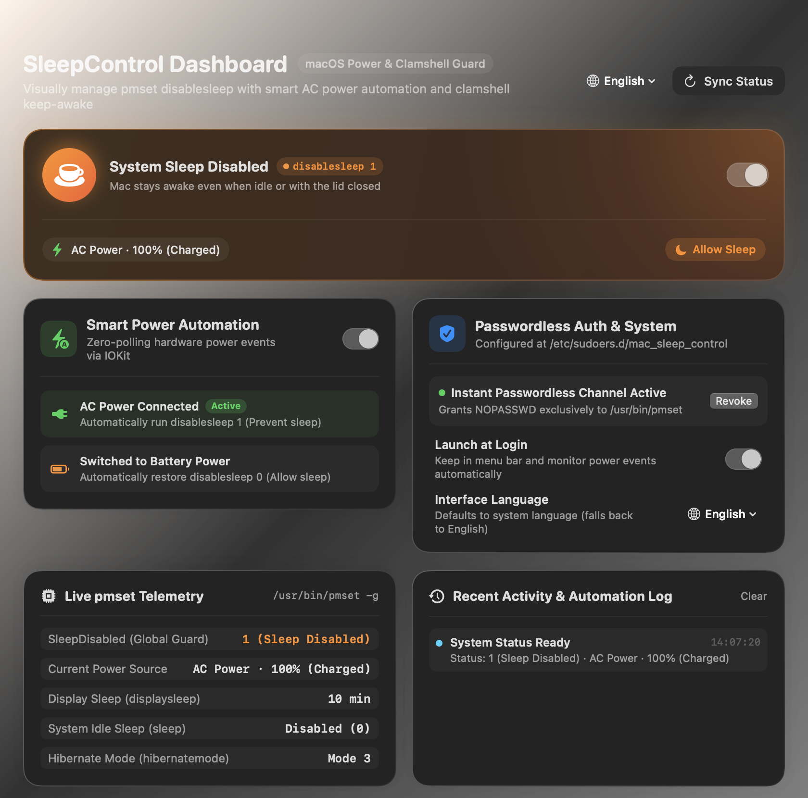
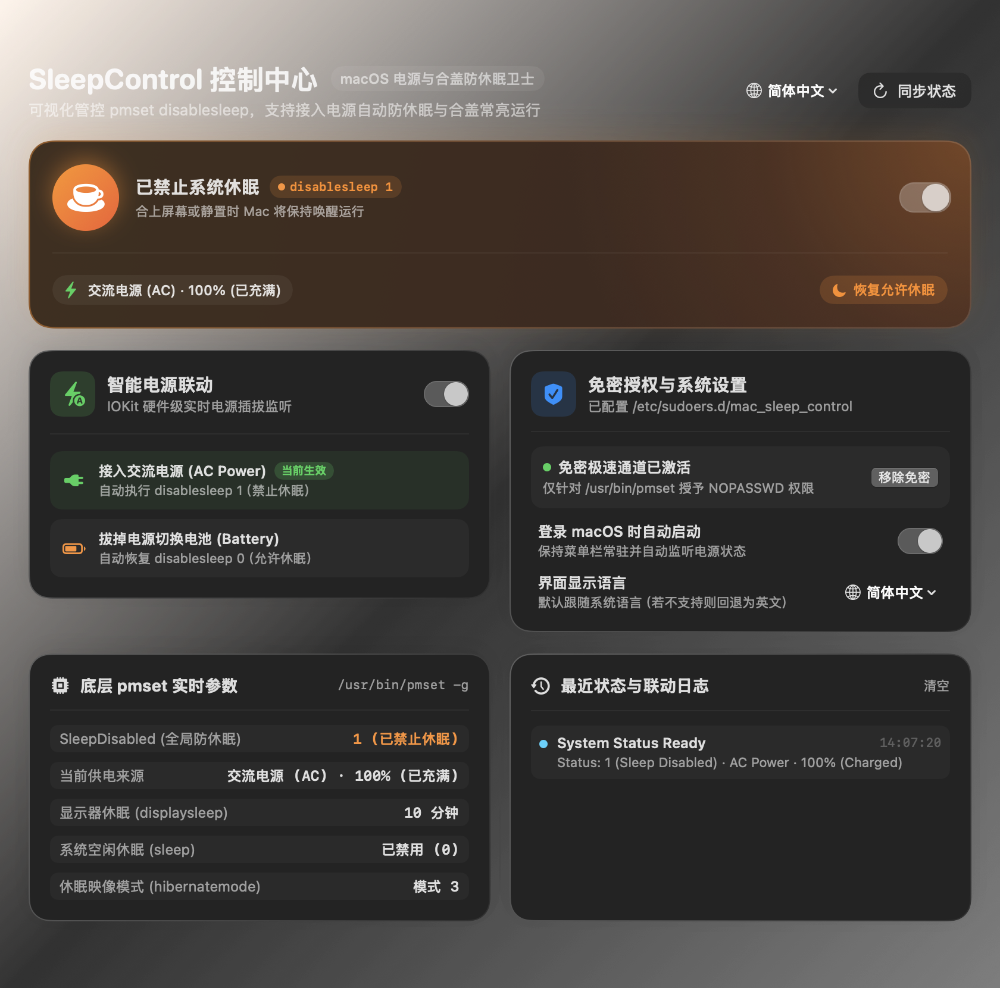
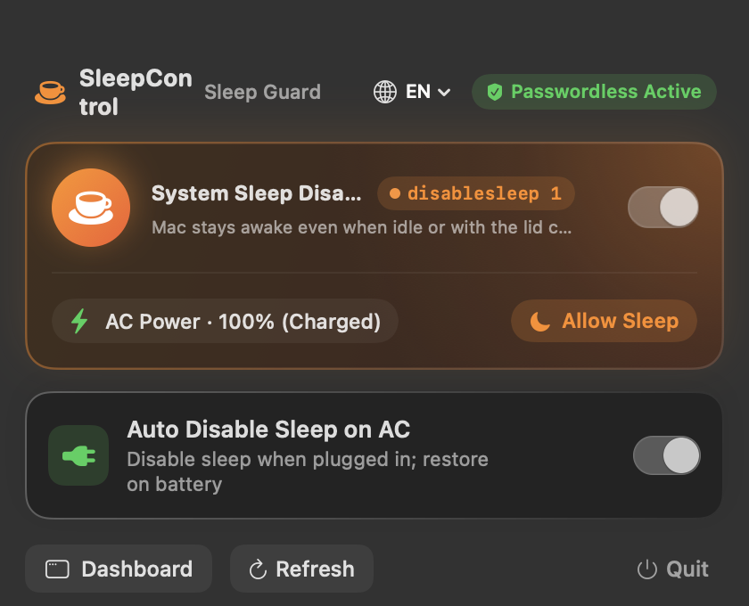
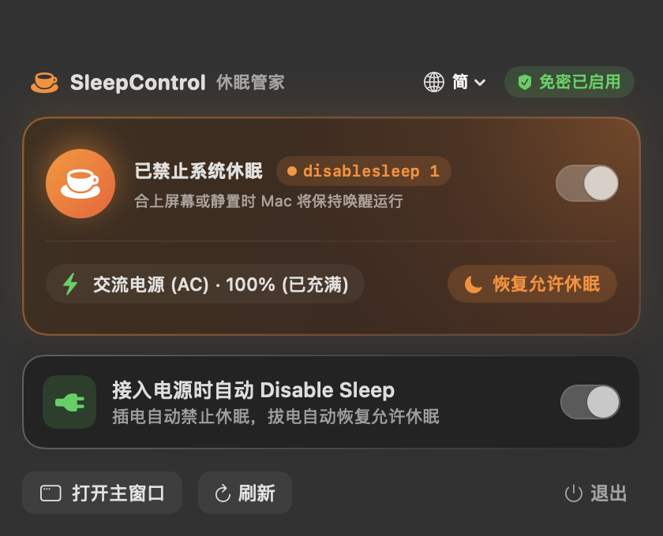

# SleepControl — macOS Power & Sleep Management Utility

[](https://www.apple.com/macos/)
[](https://swift.org)
[](LICENSE)
[]()


`SleepControl.app` is a modern native macOS utility built with **Swift + SwiftUI + AppKit + IOKit**. It seamlessly bridges `sudo pmset -a disablesleep 1` (preventing system and clamshell sleep) and `sudo pmset -a disablesleep 0` (restoring default energy conservation) into an elegant, lightweight desktop app.

---

## 📸 Screenshots

### Bento Control Dashboard
| English (`en`) | Simplified Chinese (`zh-Hans`) |
| :---: | :---: |
|  |  |

### Menu Bar Quick Popover
| English (`en`) | Simplified Chinese (`zh-Hans`) |
| :---: | :---: |
|  |  |

---

## ✨ Key Features

1. **One-Click Toggle & Real-Time Status Synchronization**
   - Live telemetry monitoring of `SleepDisabled` via `/usr/bin/pmset -g`, display sleep timer, system sleep mode, and battery status.
   - Seamless toggling between sleep allowed and sleep disabled from either the **Menu Bar Popover** or the standalone **Bento Dashboard Window**.
   - External CLI changes (e.g., executing `pmset` in Terminal) are automatically synchronized in real time.

2. **Smart AC Power Automation (Zero-Polling Hardware Events)**
   - Monitors AC/Battery power transition events in real time using macOS `IOKit.ps` (`IOPSNotificationCreateRunLoopSource`) with **zero CPU polling overhead**.
   - When **"Auto Disable Sleep on AC"** is enabled:
     - **Connected to AC Power**: Automatically executes `sudo pmset -a disablesleep 1` (keeps Mac awake even when the lid is closed).
     - **Switched to Battery Power**: Automatically restores `sudo pmset -a disablesleep 0` (preserves battery life).

3. **One-Click Passwordless Sudo Authorization (Safe `visudo` Verification)**
   - Built-in one-click setup to configure passwordless execution exclusively for `/usr/bin/pmset`.
   - Requires administrator authentication only once via macOS native Touch ID / Password prompt.
   - Safely verified using `/usr/sbin/visudo -cf` before writing to `/etc/sudoers.d/mac_sleep_control` (permissions `0440`).
   - All subsequent toggles and power-event triggers execute silently in milliseconds without intrusive password dialogs. Can be revoked at any time.

4. **Multi-Language Support (i18n)**
   - Fully localized across 5 languages:
     - **English (`en`)** (Default fallback)
     - **Simplified Chinese (`zh-Hans`)**
     - **Traditional Chinese - Taiwan (`zh-Hant-TW`)**
     - **Traditional Chinese - Hong Kong (`zh-Hant-HK`)**
     - **Japanese (`ja`)**
   - Supports instant runtime language switching from the menu bar or dashboard without requiring an application restart.

5. **Clean Dock & Menu Bar Integration**
   - Compact 22pt status bar icon with `⌘ Command + Drag` position reordering.
   - Automatically hides from the Dock (`.accessory` activation policy) when the main dashboard is closed, maintaining a clutter-free workspace while running silently in the background.
   - Re-summon the dashboard anytime via the Menu Bar Popover, Dock click, or Finder.

---

## 🚀 Building from Source

### Prerequisites
- macOS 14.0 (Sonoma) or later
- Xcode 15.0+ or Swift 5.10+ command line tools

### Build & Package Bundle
Clone the repository and run the automated build script:

```zsh
git clone https://github.com/himanzero/app-mac-sleep-control.git
cd app-mac-sleep-control
./build_app.sh
```

The script compiles the release binary, creates the iconset, packages the `.app` bundle with all localization `.lproj` directories, and applies an ad-hoc codesign signature.

```zsh
# Launch the app directly
open SleepControl.app

# Or copy to Applications
cp -R SleepControl.app /Applications/
```

---

## 🔒 Security & Privacy

`SleepControl` is completely open-source and respects your system integrity:
- **No Network Telemetry**: Zero data collection, tracking, or network requests.
- **Scoped Privilege Boundary**: Passwordless sudoers configuration is strictly scoped to `/usr/bin/pmset` with read/write protections and syntax validation.
- **Safe Sandboxing of Settings**: Preferences are stored locally in standard `UserDefaults`.

---

## 📄 License

This project is open-source software licensed under the [MIT License](LICENSE).
